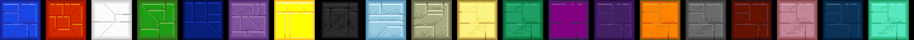

# Open Annihilation: Unbound

**Open Annihilation: Unbound** is the latest version of
[Open Annihilation](https://github.com/open-annihilation/open-annihilation),
the open-source engine that plays **Total Annihilation** from your own copy
of the game's data, with the map limits removed:

- **Unrestricted map sizes.** Maps can be larger than the original game's
  63x63 limit.
- **No tile limit.** A map is no longer limited to 65,536 tile images (tile
  numbers 0 to 65,535), so one giant map can hold many different tilesets.

Everything else is Open Annihilation: campaigns, skirmish, network play,
mods and the rest work the same way.

Open Annihilation: Unbound was designed to complement the new
[Total Annihilation Galaxy Editor](https://github.com/MattA9K/Total-Annihilation-Galaxy-Editor),
so the large, many-tileset maps you make in the editor can be played in the
game.

> **Side note: 20 team colours.** Unbound also has ten more team colours to
> pick from, 20 in all. They don't change anything about how the game plays;
> I added them because this is the version of Open Annihilation I play the
> most, and I thought more colour choices would be cool.
>
> 

No game data is included. You need an installed copy of Total Annihilation
with the 3.1 update, such as the GOG edition.

Open Annihilation: Unbound is an independent project. It is not affiliated
with or endorsed by the Open Annihilation project or the owners of Total
Annihilation. Total Annihilation, including its name, game data and other
content, is the copyright and trademark of its respective owners.
